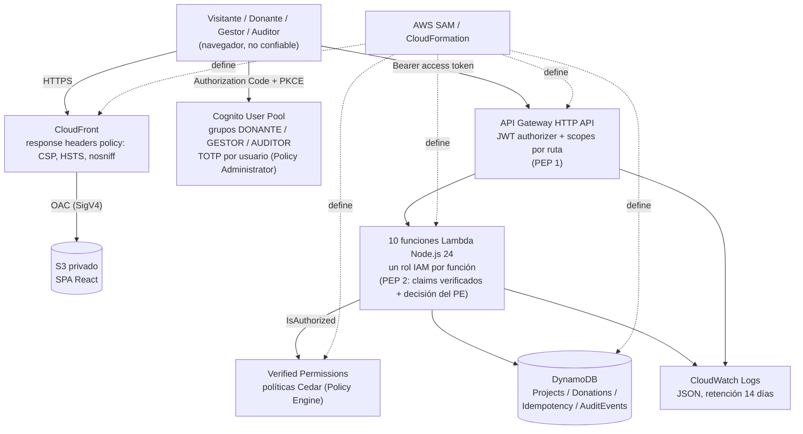

# Plataforma de Donaciones Seguras (2026)

Prototipo académico del curso *Tópicos Avanzados en Ingeniería de Software* (EPIS, UNSA). Una fundación ficticia
(«Fundación AQP-SOLIDARIA») publica proyectos sociales y recibe **intenciones de donación simuladas**. El objetivo
pedagógico es aplicar un modelo de seguridad Zero Trust (NIST SP 800-207) sobre una aplicación serverless en AWS y
demostrarlo con pruebas negativas.

> **Alcance académico.** No se procesa ningún pago real: no se solicitan ni almacenan datos de tarjeta, cuentas
> bancarias ni documentos de identidad, y no se realiza ningún cargo. Usuarios y proyectos son de prueba. La
> interfaz informa que se trata de una simulación. Un despliegue real exigiría un proveedor de pagos, conciliación y
> una evaluación legal (Ley N.º 29733, tributación y prevención de fraude).

Documentos de referencia: [requirements.md](requirements.md) (requerimientos y pruebas T01–T14),
[design.md](design.md) (diseño), [docs/threat-model.md](docs/threat-model.md) (modelo de amenazas y mapeo NIST),
[docs/api.yaml](docs/api.yaml) (OpenAPI 3.1), [evidence/](evidence/README.md) (evidencias) y
[AI_USAGE.md](AI_USAGE.md) (declaración de uso de IA) e [informe técnico](docs/informe-tecnico.md).

## Arquitectura



| Capa | Implementación | Ubicación |
|---|---|---|
| Frontend | React 19 + Vite + Tailwind; `oidc-client-ts` con tokens solo en memoria | `frontend/` |
| Entrega | S3 privado + CloudFront con OAC y política de cabeceras de seguridad | `infra/template.yaml` |
| Identidad | Cognito User Pool, dominio alojado, grupos, scopes `api/*`, app client público (sin secreto, solo flujo `code`); la SPA usa PKCE | `infra/template.yaml` |
| API | API Gateway HTTP API con JWT authorizer por defecto, scopes por ruta, CORS restringido y limitación de tasa | `infra/template.yaml` |
| Lógica | 10 funciones Lambda (TypeScript, Node.js 24, empaquetadas con esbuild) | `backend/src/` |
| Autorización | Verified Permissions con validación `STRICT` y esquema embebido: una política Cedar por regla; Lambda construye el contexto desde claims verificados | `policies/`, `backend/src/authz/` |
| Datos | 4 tablas DynamoDB bajo demanda; idempotencia y transiciones con `TransactWriteItems` condicionado | `backend/src/donations/` |

La ruta `POST /v1/donations/{donationId}/simulate` y su función solo existen en el stage `academic`
(condición `IsAcademicStage`).

### Desviaciones respecto de design.md

- **Región `us-east-2` en lugar de `us-east-1`.** El diseño recomienda `us-east-1`, pero la cuenta pertenece a una
  AWS Organization cuya política de control de servicios (SCP) deniega todas las demás regiones. Por eso el
  despliegue, `infra/samconfig.toml` y todos los comandos de este README usan `us-east-2`. El diseño exige una sola
  región, y esa condición se cumple.
- **La autorización usa Verified Permissions en todas las rutas protegidas.** El diseño plantea RBAC embebido para
  el MVP y Verified Permissions como extensión (HU-12); la implementación evalúa directamente con Cedar (no hay
  RBAC embebido paralelo). El módulo `authz` solo extrae claims verificados y comprueba scopes.
- **CI en un único `ci.yml`** (backend y frontend como trabajos separados), tal como propone design.md §8.
- **AWS Budgets es opcional**: se crea solo si se indica `BudgetAlertEmail` al desplegar.

## Requisitos previos

- Node.js 24 y npm.
- AWS CLI ≥ 2.32 (necesaria para `aws login`) y AWS SAM CLI.
- Una cuenta AWS del equipo con un usuario IAM propio (con MFA) con permisos para CloudFormation, IAM, Lambda,
  API Gateway, DynamoDB, Cognito, Verified Permissions, S3, CloudFront y CloudWatch Logs (y Budgets si se usa la
  alerta). Alternativa: ejecutar los comandos en AWS CloudShell.
- Bash (Linux, macOS, Git Bash o CloudShell) y `curl` para los scripts de `scripts/`.

## Restricciones de la cuenta AWS

- **Plan Free** (una cuenta por equipo). Antes de desplegar, verifique que cada servicio esté en la lista oficial del
  plan (CA-NF09.1; ver design.md §7). Evite MFA por SMS, Cognito Plus, WAF y servicios fuera de la lista.
- **Una sola región: `us-east-2`**, por la SCP de la organización (ver arriba). Los servicios globales (CloudFront,
  IAM, Budgets) no dependen de la región.
- **No se trabaja con el usuario root.** Cada integrante usa un usuario IAM con MFA y **sin llaves de acceso de larga
  duración**. La autenticación de la CLI se hace con `aws login` (credenciales temporales) o desde CloudShell.
- **Alerta de presupuesto (CA-NF09.1):** despliegue con `BudgetAlertEmail=<correo>` para crear un presupuesto mensual de
  1 USD con aviso al 80 % del gasto real, o cree una alerta equivalente en la consola de AWS Budgets.

## Despliegue paso a paso

```bash
# 1. Credenciales temporales (se abre el navegador para iniciar sesión)
aws login
aws sts get-caller-identity          # comprobación; no publique la salida (contiene el id de cuenta)

# 2. Compilar el backend (SAM empaqueta ../backend/dist; NO se usa `sam build`)
cd backend
npm ci
npm run build

# 3. Validar y desplegar la infraestructura
cd ../infra
sam validate --lint
sam deploy
```

- `sam deploy` lee `infra/samconfig.toml` (pila `secure-donations-backend-academic`, región `us-east-2`,
  `StageName=academic`, `confirm_changeset = true`) y pide confirmar el conjunto de cambios.
- Para crear el presupuesto, repita siempre los parámetros completos (una opción de línea de comandos reemplaza
  `parameter_overrides` del archivo):

  ```bash
  sam deploy --parameter-overrides StageName=academic BudgetAlertEmail=<correo>
  ```

  Si un despliegue posterior omite `BudgetAlertEmail`, el presupuesto se elimina de la pila.
- Salidas de la pila: `HttpApiEndpoint`, `CognitoUserPoolId`, `CognitoUserPoolClientId`, `CognitoHostedDomain`,
  `VerifiedPermissionsPolicyStoreId`, `FrontendBucketName`, `CloudFrontDistributionId`, `CloudFrontDomainName` y
  `FrontendUrl`:

  ```bash
  aws cloudformation describe-stacks --region us-east-2 --stack-name secure-donations-backend-academic \
    --query "Stacks[0].Outputs[].[OutputKey,OutputValue]" --output table
  ```

## Publicar el frontend

El frontend se compila con las salidas de la pila y se sube al bucket privado; solo CloudFront puede leerlo.

```bash
STACK=secure-donations-backend-academic
REGION=us-east-2
out() { aws cloudformation describe-stacks --region "$REGION" --stack-name "$STACK" \
  --query "Stacks[0].Outputs[?OutputKey=='$1'].OutputValue" --output text; }

cd frontend
npm ci
VITE_API_URL="$(out HttpApiEndpoint)" \
VITE_COGNITO_USER_POOL_ID="$(out CognitoUserPoolId)" \
VITE_COGNITO_CLIENT_ID="$(out CognitoUserPoolClientId)" \
VITE_COGNITO_DOMAIN="$(out CognitoHostedDomain)" \
npm run build

aws s3 sync dist "s3://$(out FrontendBucketName)" --delete --region "$REGION"
aws cloudfront create-invalidation --distribution-id "$(out CloudFrontDistributionId)" --paths "/*"
```

Las variables `VITE_*` no son secretas (URLs e identificadores públicos), pero no se versionan archivos `.env`.
Abra la URL de la salida `FrontendUrl`. Los tokens viven solo en memoria (CA-NF11.1) y no se guardan en ningún
almacenamiento. Al recargar la página (F5) la SPA los pierde, pero si en esa pestaña había una sesión inicia una sola vez
un nuevo flujo Authorization Code + PKCE: mientras la sesión del dominio alojado de Cognito siga vigente, el usuario vuelve
a la misma ruta sin escribir credenciales; si venció, Cognito muestra su inicio de sesión habitual. Para ello solo se guarda
en `sessionStorage` una bandera booleana, sin token, identificador ni claim, que se borra al cerrar sesión y ante cualquier
error de autenticación.

**Borradores (HU-08).** Un GESTOR crea proyectos en estado BORRADOR y los publica desde la sección «Borradores»
(`/projects/drafts`), que consume `GET /v1/projects/drafts`. La ruta exige el scope `api/projects.write` y que Verified
Permissions autorice la acción `ListDraftProjects` al grupo GESTOR; cualquier GESTOR ve todos los borradores. El
enlace de la navegación solo es una ayuda de UX: el backend decide. El catálogo público y el detalle siguen sin exponer
borradores (CA-01.2, CA-02.2).

## Usuarios de prueba y MFA

Las pruebas requieren un usuario por rol: dos `DONANTE` (T09 necesita un segundo), un `GESTOR` y un `AUDITOR`.
[`scripts/create-test-users.sh`](scripts/create-test-users.sh) los crea con `admin-create-user` y los agrega a su grupo;
Cognito envía la contraseña temporal por correo (el script nunca contiene ni imprime contraseñas):

```bash
bash scripts/create-test-users.sh \
  --donor <correo-donante> --donor2 <correo-donante-2> \
  --manager <correo-gestor> --auditor <correo-auditor>
```

**MFA TOTP obligatorio (CA-11.1).** El user pool tiene `MfaConfiguration: "ON"` con TOTP y sin SMS. En el primer
inicio de sesión, el login administrado de Cognito pide cambiar la contraseña temporal, muestra el código QR para
registrar una aplicación autenticadora y verifica el primer código; sin segundo factor no se emiten tokens.

Esto es más estricto que la matriz de `requirements.md`, que exige MFA solo a GESTOR y AUDITOR y lo deja opcional
para DONANTE. Se eligió así porque, con MFA opcional, el login administrado no ofrece registrar TOTP y un usuario
privilegiado podría entrar solo con contraseña. La desviación debe constar en el informe. La evidencia de CA-11.2 es
la prueba T14. El modo `--enforce-mfa` del script ya no es necesario.

## Pruebas

**Locales (no usan AWS):**

```bash
cd backend && npm ci && npm run typecheck && npm test      # 205 pruebas Vitest
cd frontend && npm ci && npm run lint && npm run build
```

**CI (GitHub Actions, [`.github/workflows/ci.yml`](.github/workflows/ci.yml)).** En cada pull request y en cada push a
`main` ejecuta dos trabajos con Node 24 y `npm ci`: *backend* (typecheck, pruebas con cobertura, build y
`npm audit --audit-level=high`) y *frontend* (lint, build y `npm audit --audit-level=high`). No hay paso de despliegue
ni credenciales de AWS.

**Aceptación contra el despliegue ([`scripts/acceptance.sh`](scripts/acceptance.sh)).** Ejecuta T01–T12 y T03b (borradores solo para GESTOR) con `curl`.
Lee los tokens solo de variables de entorno (`DONOR_ACCESS_TOKEN`, `DONOR_ID_TOKEN`, `DONOR2_ACCESS_TOKEN`,
`MANAGER_ACCESS_TOKEN`), no los imprime, informa `SKIPPED` cuando falta un token y termina con código distinto de cero
si alguna prueba falla. La cabecera del script explica cómo obtener los tokens sin automatizar el ingreso de
credenciales (flujo de código con PKCE en la interfaz alojada o copia desde la pestaña Red de su propia sesión).

```bash
export API_URL="$(aws cloudformation describe-stacks --region us-east-2 --stack-name secure-donations-backend-academic \
  --query "Stacks[0].Outputs[?OutputKey=='HttpApiEndpoint'].OutputValue" --output text)"
# ...defina los tokens según la cabecera del script...
bash scripts/acceptance.sh
```

T10, T13 y T14 no se pueden automatizar solo con `curl`: el script imprime el procedimiento manual. Los resultados
verificados y los pendientes están en [evidence/2026-11-11-smoke.md](evidence/2026-11-11-smoke.md); una prueba pendiente
no debe presentarse como superada.

## Limpieza (CA-NF09.2)

1. Vacíe el bucket del frontend (CloudFormation no elimina buckets con objetos):

   ```bash
   aws s3 rm "s3://<FrontendBucketName>" --recursive --region us-east-2
   ```

2. Elimine la pila (incluye Cognito, API, funciones, tablas, Verified Permissions, CloudFront y el presupuesto):

   ```bash
   sam delete --stack-name secure-donations-backend-academic --region us-east-2
   ```

3. Verifique que no queden recursos:
   - Grupos de logs de Lambda creados automáticamente en despliegues anteriores a `LoggingConfig` (no pertenecen a la
     pila): `aws logs describe-log-groups --region us-east-2 --log-group-name-prefix /aws/lambda/` y elimine los del
     proyecto con `aws logs delete-log-group --log-group-name <nombre>`. Los grupos `/aws/vendedlogs/secure-donations/`
     sí se eliminan con la pila.
   - Pila administrada por SAM que guarda los artefactos (`resolve_s3 = true`): si ningún otro proyecto la usa,
     vacíe su bucket y elimine la pila `aws-sam-cli-managed-default`
     (`aws cloudformation delete-stack --region us-east-2 --stack-name aws-sam-cli-managed-default`).
   - Tag Editor o Resource Explorer para buscar recursos residuales.

## Estructura del repositorio

```text
.
├── .github/workflows/ci.yml   # CI: lint, typecheck, pruebas, build y npm audit
├── backend/                   # Lambda (TypeScript): projects, donations, authz, audit, shared
│   ├── src/
│   ├── tests/                 # Vitest
│   └── build.mjs              # empaquetado con esbuild hacia dist/
├── frontend/                  # React + Vite + Tailwind; src/auth (OIDC, tokens en memoria)
├── infra/
│   ├── template.yaml          # AWS SAM (stage academic)
│   └── samconfig.toml
├── policies/                  # Políticas Cedar y esquema (reflejadas en template.yaml)
├── docs/
│   ├── api.yaml               # OpenAPI 3.1
│   └── threat-model.md        # STRIDE por frontera + mapeo NIST SP 800-207
├── evidence/                  # Evidencias sanitizadas de las pruebas
├── scripts/
│   ├── acceptance.sh          # T01–T12 y T03b contra el despliegue
│   └── create-test-users.sh   # usuarios de prueba y TOTP
├── requirements.md
├── design.md
├── AI_USAGE.md
└── README.md
```

## Limitaciones conocidas

- El JWT authorizer no consulta revocaciones: un access token revocado se acepta hasta expirar (≤ 15 min).
- No hay verificación de postura del dispositivo, evaluación continua de riesgo ni ZTNA.
- HTTP API no se integra con AWS WAF; no hay WAF delante de CloudFront.
- El MFA se exige en Cognito para todos los usuarios (`MfaConfiguration: "ON"`); el access token no incluye el claim
  `amr`, por lo que la política Cedar de auditoría no comprueba MFA.
- El almacén de Verified Permissions valida las políticas con `Mode: "STRICT"` contra un esquema embebido en la
  plantilla (`policies/schema.cedarschema` es su forma legible). La política `ReadMyDonations` solo exige el grupo
  `DONANTE`: la propiedad del historial se garantiza porque la consulta usa el `sub` del token como clave y no acepta
  identificadores del cliente.
- `AuditEvents` registra las escrituras exitosas y los rechazos posteriores a la autenticación (`DENIED`, `FAILURE`,
  `ERROR`) de los siete handlers protegidos; no registra consultas exitosas ni las solicitudes que API Gateway rechaza
  antes de invocar a Lambda.
- Los permisos de logs de Lambda vienen del rol administrado `AWSLambdaBasicExecutionRole`.

El detalle, los controles asociados y las respuestas a las preguntas de discusión están en
[docs/threat-model.md](docs/threat-model.md).
