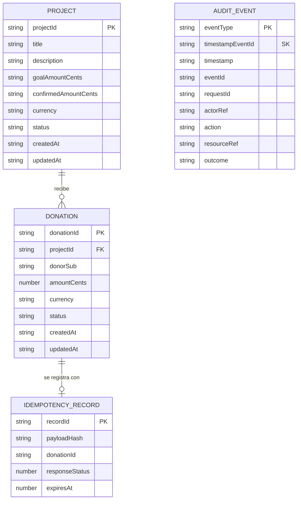
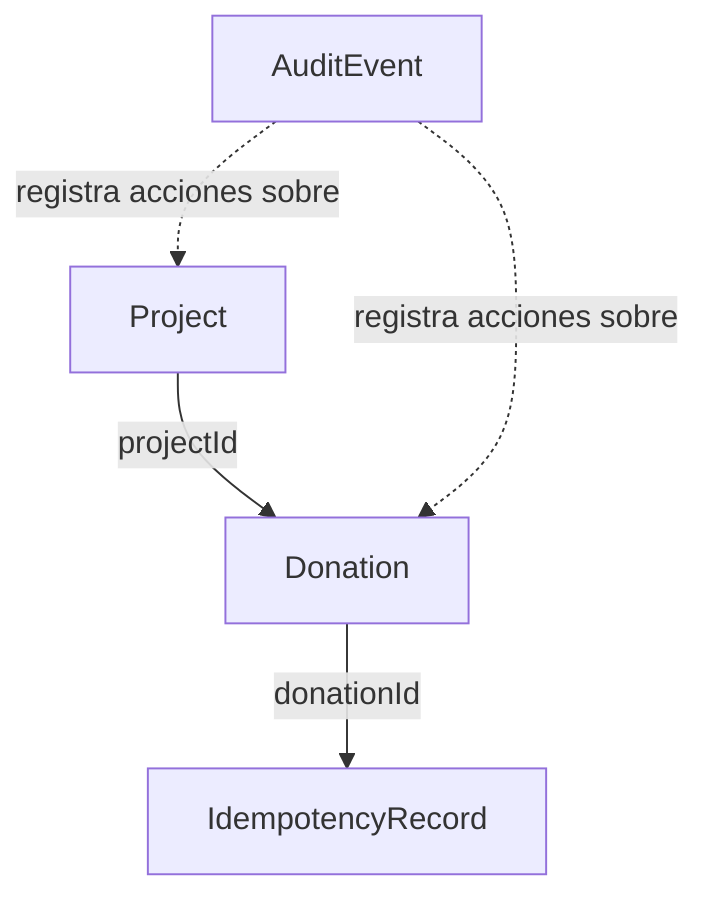
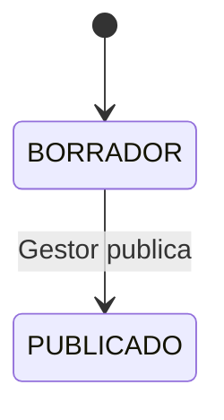
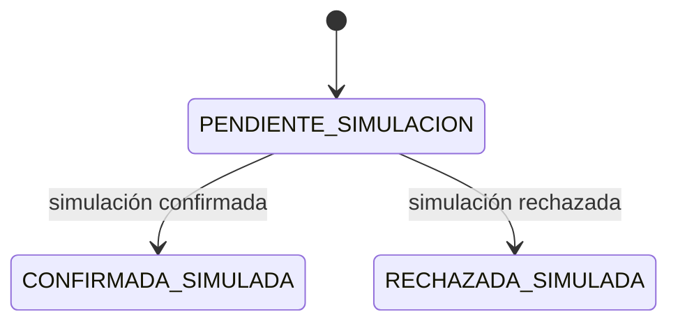

# DATA-MODEL.md — Estructura de datos

Modelo lógico de las cuatro estructuras persistidas en DynamoDB, basado en `requirements.md` y `design.md`.

## Diagrama entidad-relación

## Relaciones y estados

## Persistencia en DynamoDB

| Tabla | Clave primaria | Índices y expiración | Propósito |
|---|---|---|---|
| `Projects` | PK: `projectId` | GSI `status-createdAt` para listar proyectos publicados | Datos del proyecto y acumulado confirmado. |
| `Donations` | PK: `donationId` | GSI `donorSub-createdAt` para historial propio | Intenciones de donación, propietario, importe y estado. |
| `Idempotency` | PK: `recordId` | TTL `expiresAt` (24 horas) | Evitar duplicados y recuperar la respuesta original. |
| `AuditEvents` | PK: `eventType`; SK: `timestamp#eventId` | Consulta por tipo y rango temporal | Eventos de auditoría y trazabilidad. |

## Atributos principales

- **Project:** `projectId`, `title`, `description`, `goalAmountCents`, `confirmedAmountCents`, `currency=PEN`, `status`, `createdAt`, `updatedAt`. `status`: `BORRADOR` o `PUBLICADO`.
- **Donation:** `donationId`, `projectId`, `donorSub`, `amountCents`, `currency=PEN`, `status`, `createdAt`, `updatedAt`. `status`: `PENDIENTE_SIMULACION`, `CONFIRMADA_SIMULADA` o `RECHAZADA_SIMULADA`.
- **IdempotencyRecord:** `pk`, `payloadHash` (SHA-256 del body normalizado), `donationId`, `responseStatus`, `expiresAt` (TTL).
- **AuditEvent:** `eventType`, `timestamp`, `eventId`, `requestId`, `actorRef` seudonimizado, `action`, `resourceRef`, `outcome`.

## Reglas de integridad

1. Los importes son enteros en céntimos de PEN; `100` representa S/ 1.00. No usar `float`.
2. `donorSub` y el actor autenticado se derivan de claims verificados, nunca de valores confiados al navegador.
3. La clave de idempotencia identifica al usuario y la operación: `donorSub#createDonation#idempotencyKey`.
4. La reserva de la clave y la creación de la donación se realizan juntas con DynamoDB `TransactWriteItems`.
5. La misma clave con el mismo hash devuelve la respuesta original; con hash diferente devuelve `409 Conflict`.
6. La donación solo puede pasar de `PENDIENTE_SIMULACION` a uno de los dos estados terminales.
7. La confirmación y el incremento de `confirmedAmountCents` se ejecutan en una transacción condicionada; no se cuenta dos veces.
8. Las donaciones rechazadas y pendientes no incrementan el total del proyecto.
9. El historial se consulta por el GSI `donorSub-createdAt` usando el `sub` autenticado.
10. Los eventos de auditoría no almacenan tokens, secretos, datos de tarjetas ni claves de idempotencia.
"""