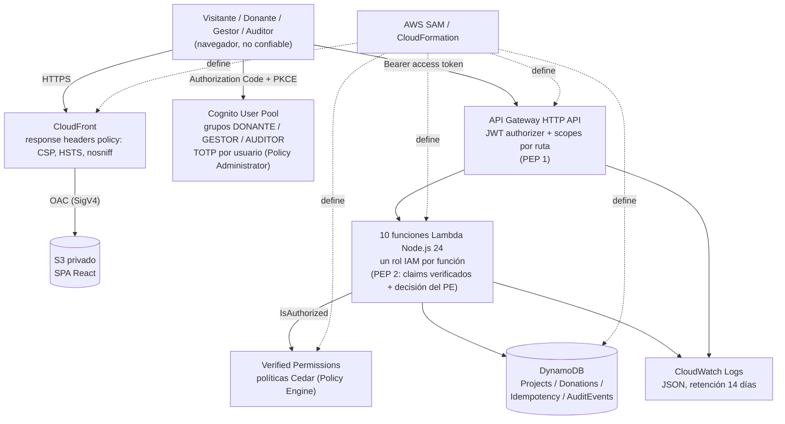

# Informe técnico — Plataforma de Donaciones Seguras (2026)

Curso *Tópicos Avanzados en Ingeniería de Software* (EPIS, UNSA). Prototipo académico con donaciones simuladas sobre un
modelo de seguridad Zero Trust (NIST SP 800-207). Lo que no se ejecutó o no se midió se declara como pendiente.

## 1. Contexto y alcance

Una fundación ficticia («Fundación AQP-SOLIDARIA») publica proyectos sociales y recibe intenciones de donación
simuladas. No hay pagos reales, datos de tarjeta ni cargos. El alcance cubre las historias HU-01 a HU-09 y HU-11 (MVP),
más las extensiones HU-10 (auditoría) y HU-12 (autorización externalizada). Quedan fuera la postura de dispositivo, la
evaluación continua de riesgo, ZTNA, WAF y los pagos reales.

Despliegue verificado el 2026-11-11, región `us-east-2`.

## 2. Arquitectura desplegada y límites de confianza

Límites de confianza, en el orden en que una solicitud los cruza: navegador a CloudFront/S3; navegador a Cognito;
navegador a API Gateway (el JWT authorizer valida emisor, firma, expiración, `client_id` y scope); API Gateway a Lambda
(el handler lee identidad y grupos solo de claims verificados); Lambda a Verified Permissions; Lambda a DynamoDB, con un
rol IAM por función. El navegador y la red no son confiables. El detalle STRIDE está en
[threat-model.md](threat-model.md).

## 3. Decisiones arquitectónicas y su realización

| Decisión | Cómo se realizó |
|---|---|
| AD-01 Zero Trust | Autenticación y autorización en cada solicitud protegida; rol IAM por función; registro de eventos |
| AD-02 Serverless modular | SPA React estática; 10 funciones Lambda (TypeScript) en módulos `projects`, `donations`, `authz`, `audit` y `shared` |
| AD-03 Transacciones simuladas | Estados simulados, sin datos de pago; la ruta de simulación existe solo en el stage `academic` (condición `IsAcademicStage`); la interfaz muestra «Simulación académica: no se ha realizado ningún cobro» |
| AD-04 Backend autoritativo | Validación con Zod (`amountCents` entero entre 100 y 100000, `Idempotency-Key` UUID); importes en céntimos; `donorSub` solo del token |
| AD-05 Idempotencia atómica | Reserva de clave y creación de la donación en un único `TransactWriteItems` condicionado |
| AD-06 Cuenta Free plan | Una sola región; presupuesto de AWS Budgets como parámetro opcional (ver §10) |
| AD-07 Tokens de vida corta | Access e ID token de 15 minutos; refresh token de 1 día con revocación habilitada |
| AD-08 Autorización en dos niveles | Se implementó Verified Permissions en todas las rutas protegidas; no hay RBAC embebido paralelo (ver §9) |

## 4. Mapeo a NIST SP 800-207

Componentes: **PEP 1** es el JWT authorizer de API Gateway (y CloudFront para el sitio); **PEP 2** es el handler, que
aplica la decisión del motor y falla cerrado; el **Policy Engine** es Verified Permissions con políticas Cedar; el
**Policy Administrator** es Cognito (autentica, exige TOTP, emite, renueva y revoca tokens). Las **fuentes de
información** son los claims, el estado del recurso en DynamoDB, los logs de CloudWatch, `AuditEvents` y el historial de
eventos de CloudTrail.

| # | Principio | Control | Evidencia | Cobertura |
|---|---|---|---|---|
| 1 | Todo es un recurso | Autorización explícita por ruta; rol y tablas propios por función | T10 (estática) | Total |
| 2 | Comunicación segura | HTTPS en CloudFront y API Gateway; S3 solo vía OAC | Redirección 301 y acceso directo a S3 con 403 (smoke) | Total |
| 3 | Acceso por sesión y recurso | Token de 15 min, scope por ruta, propiedad por recurso | T09, T11, T13 | Total, con la limitación de revocación (T13) |
| 4 | Política dinámica | Decisión por solicitud con grupo, `sub`, estado del recurso y stage | T03, T12 | Total respecto del diseño |
| 5 | Monitorear la postura | CloudTrail y `npm audit` en CI | CI | **Parcial** |
| 6 | Autenticación y autorización estrictas | JWT authorizer + Verified Permissions + TOTP | T02, T11, T14 | Total en diseño; T14 pendiente |
| 7 | Recolectar información | Logs JSON, `AuditEvents`, CloudTrail | Ver §8 | Total en recolección; sin análisis automático |

Tablas completas en [threat-model.md](threat-model.md) §3.

## 5. Resultados de las pruebas T01–T14

Ejecución con usuarios reales (dos DONANTE y un GESTOR, con MFA TOTP) el 2026-11-11: **11 PASS, 0 FAIL, 3 SKIPPED**
(T10, T13 y T14 no son automatizables con `curl`); T13 se ejecutó después de forma manual y pasó. Detalle en
[evidence/2026-11-11-acceptance.md](../evidence/2026-11-11-acceptance.md).

| ID | Estado | Resultado | Evidencia |
|---|---|---|---|
| T01 | PASS | 200 sin borradores | acceptance |
| T02 | PASS | 401 sin token | acceptance |
| T03 | PASS | 403 al donante que crea proyecto | acceptance |
| T04 | PASS | 400 con 0, 100001, 12.5, `"2500"` y sin `Idempotency-Key` | acceptance |
| T05 | PASS | 201, `PENDIENTE_SIMULACION` | acceptance |
| T06 | PASS | Mismo `donationId`; el historial creció en 1 | acceptance |
| T07 | PASS | 409 con otra carga | acceptance |
| T08 | PASS | 10 confirmaciones paralelas: 1×200, 9×409, un solo incremento de +1000 céntimos | acceptance |
| T09 | PASS | 403 sin filtración sobre una donación ajena | acceptance |
| T10 | Evidencia estática | El rol del listado solo permite `dynamodb:Query` sobre el índice del catálogo | smoke §3.3 |
| T11 | PASS con desviación | Token alterado: 401; ID token: 403 | acceptance |
| T12 | PASS | 403 al gestor; sin datos de donaciones | acceptance |
| T13 | PASS | Token revocado: 200 hasta expirar, 401 tras la expiración | acceptance |
| T14 | Pendiente | Captura manual pendiente | acceptance |

**T10.** Solo evidencia estática: el IAM Policy Simulator no es utilizable en esta cuenta, porque la SCP de la
organización hace que devuelva `explicitDeny` para cualquier acción.

**T13.** Con el mismo access token (vence a las 20:11:48 UTC): 19:56:48 dio 200; hacia las 19:57:00 se revocó el
refresh token con `/oauth2/revoke` (200); a las 19:57:04, 19:57:34, 20:01:45, 20:02:58, 20:03:01 y 20:03:02 el token
siguió dando 200; renovar con el refresh token revocado dio `invalid_grant`; a las 20:11:50, dos segundos tras expirar,
dio 401. La revocación solo bloqueó la renovación: el JWT authorizer valida firma y expiración de forma local, así que
el token revocado fue válido unos 15 minutos (CA-03.4, AD-07).

**T14 (pendiente).** Falta la captura manual de un GESTOR sin segundo factor. Está verificado que el pool tiene
`MfaConfiguration: ON`, solo TOTP y sin SMS, y CloudTrail muestra eventos `MfaRegister` en el primer inicio de sesión.

## 6. Integridad e idempotencia

La decisión (CA-NF04.2, AD-05) es usar `TransactWriteItems` con condiciones, no lecturas seguidas de escrituras. Al
crear una donación, una transacción inserta el registro de idempotencia (`attribute_not_exists(pk)`) y la donación. Al
simular, otra transacción pasa la donación de `PENDIENTE_SIMULACION` a su estado terminal con la condición
`status = PENDIENTE_SIMULACION AND donorSub = :sub` e incrementa `confirmedAmountCents` del proyecto en la misma
operación. La clave de idempotencia es `sub#createDonation#clave`, con `payloadHash` SHA-256 y TTL de 24 h. Las
cancelaciones por condición o conflicto se traducen a 409, nunca a 500. En el despliegue, T06 mostró que repetir clave y
carga devuelve la misma donación, T07 que cambiar la carga produce 409, y T08 que de 10 confirmaciones simultáneas solo
una modifica el acumulado.

## 7. Mínimo privilegio

Cada una de las 10 funciones tiene su propio rol, con las acciones y los recursos que usa: por ejemplo, el listado del
catálogo solo `Query` sobre `Projects/index/status-createdAt`, y la simulación `GetItem`/`UpdateItem` sobre `Donations`,
`UpdateItem` sobre `Projects` y `PutItem` sobre `AuditEvents`. Las políticas propias no usan `Action: "*"` ni
`Resource: "*"`. La política de Verified Permissions (`IsAuthorized` sobre el ARN del almacén) solo se adjunta a las
funciones protegidas. La demostración es la evidencia estática de T10 (§5). Limitación: el rol administrado
`AWSLambdaBasicExecutionRole` concede permisos de logs más amplios que los de la pila.

Con la auditoría de rechazos (§8), `ListMyDonationsFunction` y `ListAuditLogsFunction` reciben además `PutItem` sobre
`AuditEvents`, y nada más. La función de borradores (`ListDraftProjectsFunction`, `GET /v1/projects/drafts`, HU-08)
nace con ese mismo criterio: `Query` solo sobre `Projects/index/status-createdAt`, `PutItem` sobre `AuditEvents` y la
política de Verified Permissions; sin escritura en `Projects`. Su acción Cedar `ListDraftProjects` es la séptima y
se concede solo al grupo GESTOR. Estos cambios están en la plantilla, pero **no se han desplegado** ni verificado en
AWS.

## 8. Observabilidad

- **Logs JSON.** Cada invocación emite una línea de acceso con `requestId`, acción, resultado, código HTTP y duración,
  con retención de 14 días; el stage de API Gateway tiene su propio log. No se registran cabeceras, tokens, cuerpos ni
  el `sub` (lo comprueban pruebas unitarias).
- **`AuditEvents`.** Cada evento lleva `timestamp`, `requestId`, actor seudonimizado (`actor_` más 8 caracteres de un
  SHA-256 del `sub`, o `actor_unknown` sin identidad verificada), acción, recurso y resultado. Tras el cambio de esta
  etapa, los siete handlers protegidos registran también las operaciones rechazadas después de autenticar: `DENIED`
  (401/403), `FAILURE` (400, 404, 409) y `ERROR` (5xx). Las consultas exitosas del historial y de la auditoría no se
  registran. Un fallo al escribir el evento se anota en el log y no cambia la respuesta. Cubre CA-08.3, CA-10.2 y el
  principio 7. Estado: pruebas unitarias; **pendiente** de verificar en el despliegue.
- **CloudTrail.** Se usa el historial de eventos que AWS activa por defecto; la plantilla no define un trail propio.
- Pendiente: las capturas de CloudWatch con un caso exitoso y uno rechazado (CA-NF07.2).

## 9. Autorización embebida frente a externalizada (HU-12, CA-12.2)

El diseño planteaba RBAC embebido para el MVP y Verified Permissions como extensión. La implementación usa Verified
Permissions en todas las rutas protegidas; el módulo `authz` solo extrae claims verificados y comprueba scopes. No hay
variante embebida con la que medir: la comparación es de diseño, no experimental.

| Aspecto | Embebida (en el código) | Externalizada (Cedar + Verified Permissions) |
|---|---|---|
| Ubicación de las reglas | Condicionales en handlers | Políticas declarativas, una por regla, en la plantilla |
| Denegación por defecto | Hay que programarla | Propia del motor |
| Cambio de regla | Despliegue de código | Cambio de política en la plantilla; sigue pasando por un despliegue de la pila |
| Revisión y validación | Pruebas unitarias reales | Esquema con validación `STRICT`; las pruebas unitarias simulan el motor |
| Costo operativo | Sin dependencia adicional | Una llamada de red por solicitud; la latencia no se midió; si el servicio falla, las rutas protegidas devuelven 500 (falla cerrada) |

T03, T09 y T12 pasaron en el despliegue con el motor externo (CA-12.2). Esta etapa ajustó la política de
`ReadMyDonations`: tenía la condición `principal.sub == resource.donorSub`, pero el handler construía ese recurso con el
propio `sub` del token, de modo que comparaba al usuario consigo mismo. La política ahora solo exige el grupo
`DONANTE`; la propiedad del historial es estructural (la consulta usa el `sub` del token como clave del índice
`donorSub-createdAt` y no acepta identificadores del cliente), y hay una prueba unitaria que lo comprueba. En
`SimulateDonation` la condición de propiedad se conserva, porque el recurso se lee de DynamoDB. El almacén pasa a modo
`STRICT` con un esquema embebido; está probado de forma unitaria y **no se ha validado en AWS**.

## 10. Desviaciones respecto del diseño

1. **Región `us-east-2`** en lugar de `us-east-1`: una SCP de la organización deniega las demás regiones.
2. **MFA TOTP obligatorio para todos**, más estricto que la matriz, donde el MFA del donante es opcional: con MFA
   opcional el login administrado de Cognito no ofrece registrar TOTP.
3. **ID token como Bearer: 403, no 401** (CA-03.2): el authorizer acepta la firma y falla la comprobación de scope de la
   ruta.
4. **Los access tokens llevan todos los scopes** del único app client; el control de rol lo ejerce Verified Permissions
   a partir del grupo, no el scope.
5. Verified Permissions en todas las rutas protegidas, sin RBAC embebido (§9); un único `ci.yml`.

## 11. Limitaciones conocidas y trabajo pendiente

- Un access token revocado se acepta hasta expirar (T13, observado: unos 15 minutos).
- Sin postura de dispositivo, evaluación continua de riesgo, ZTNA ni WAF (HTTP API no lo admite); la limitación de tasa
  del stage (10 solicitudes/s, ráfaga de 20) es la única defensa.
- Sin logs de acceso de CloudFront o S3, alarmas ni respaldos de DynamoDB.
- El access token no incluye `amr`; el MFA se exige en Cognito, no en Cedar.
- Los tokens viven solo en memoria (CA-NF11.1). Al recargar, la SPA reanuda la sesión con un nuevo flujo PKCE si una
  bandera booleana de `sessionStorage` indica que hubo sesión en la pestaña; sin token ni identificador en el
  almacenamiento. Si la cookie de sesión de Cognito venció, el usuario ve el inicio de sesión de Cognito.
- Pendientes, no hechos: medición de rendimiento (RNF-HU-05), evaluación de accesibilidad (RNF-HU-06), alerta de AWS
  Budgets (el parámetro existe, pero no se indicó ningún correo), T14, la
  demostración dinámica de T10 y los campos de revisión humana de `AI_USAGE.md`.
- Los cambios de esta etapa (auditoría de rechazos, esquema `STRICT`, política de `ReadMyDonations`) solo tienen
  pruebas unitarias; no se ejecutó `cedar validate` ni un conjunto de cambios de CloudFormation.

## 12. Respuestas a las preguntas de discusión

**¿Dónde está el PEP y qué pasa si falla?** Hay dos en serie: el JWT authorizer de API Gateway (rechaza tokens
ausentes, vencidos, alterados o sin el scope de la ruta antes de invocar a Lambda) y el handler (convierte cualquier
decisión distinta de `ALLOW` en 403). Si Verified Permissions no responde o falta su configuración, el handler devuelve
500 sin ejecutar la operación; se pierde disponibilidad de las rutas protegidas, no seguridad. Si el authorizer faltara
en una ruta, el handler rechazaría con 401 al no recibir claims.

**¿Qué principio NIST se cubre solo parcialmente?** El 5 (monitorear la postura de los activos): hay CloudTrail y
`npm audit` en CI, pero no postura de dispositivo, GuardDuty, Security Hub, Config, alarmas ni Dependabot.

**¿Cómo detectar una autorización incorrecta generada por IA?** Las pruebas unitarias simulan Verified Permissions y
DynamoDB, así que no detectan una política demasiado permisiva. Detectan mejor: las pruebas negativas contra el
despliegue (T03, T09, T12); la denegación por defecto de Cedar, que convierte una omisión en un 403; la doble barrera de
propiedad en la simulación (Cedar y `donorSub = :sub` en la transacción); la validación `STRICT`, que rechaza nombres
erróneos al desplegar; la revisión en PR por otra persona; y `AuditEvents`, que ahora conserva también las denegaciones.
La condición tautológica de `ReadMyDonations` es un ejemplo: ninguna prueba falló y solo la revisión de la política
frente al handler la expuso.

**¿Qué cambia si un token robado sigue vigente 15 minutos?** Quien lo posea actúa con los permisos del rol de la víctima
durante esa ventana; el MFA no ayuda, porque el token se emite después del segundo factor. T13 mostró que el access
token revocado siguió aceptado hasta expirar (200 desde las 19:57:04 hasta las 20:03:02 UTC, 401 a las 20:11:50), mientras
que el refresh token revocado ya no renueva (`invalid_grant`). El daño queda acotado por la vida corta, la limitación de tasa, el aislamiento
por propietario y los eventos de auditoría con `requestId`. Una respuesta más fuerte sería un Lambda authorizer con
lista de revocación, que el diseño descarta por su costo.

## 13. Uso de IA

Se usaron asistentes de código en el análisis, las correcciones, la documentación y esta etapa final. La declaración
completa está en [AI_USAGE.md](../AI_USAGE.md); sus campos de revisión humana están **pendientes**.

## 14. Limpieza

Procedimiento (README, «Limpieza»): vaciar el bucket del frontend, `sam delete` sobre la pila, eliminar grupos de logs
ajenos a la pila y verificar con Tag Editor o Resource Explorer. **No se ha ejecutado**: el despliegue sigue activo
(CA-NF09.2 exige hacerlo al cerrar la evaluación).
